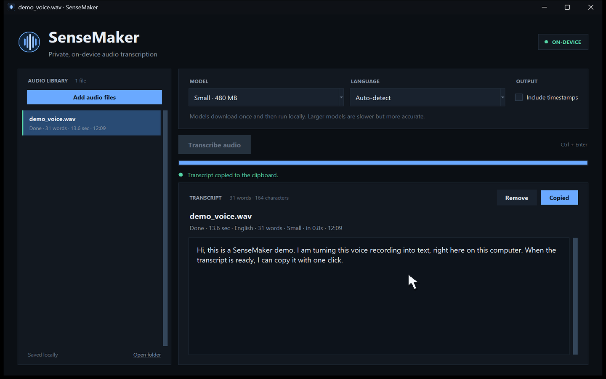

# SenseMaker

[](LICENSE)
[](https://github.com/autotelico/sensemaker/releases)

**SenseMaker** is a private, on-device audio transcription app for Windows.
It uses OpenAI's Whisper models through `faster-whisper`; audio is processed
locally and is never uploaded. It is free software under
[GPL-3.0-or-later](LICENSE).



## Download

Get the latest installer from the [Releases page](https://github.com/autotelico/sensemaker/releases).
The current build is unsigned, so Windows SmartScreen may warn that the
publisher is unrecognized. Verify downloads against `SHA256SUMS.txt`.

Building from source is described below.

## Installed app

SenseMaker is installed as a normal per-user Windows application:

- **Start Menu:** `SenseMaker` folder (app, privacy notice, uninstall)
- **Desktop:** `SenseMaker` shortcut
- **Install location:** `%LOCALAPPDATA%\Programs\SenseMaker`
- **Installer:** `dist\SenseMaker-Setup-1.0.0.exe`
- **Uninstall:** Settings → Apps → Installed apps → SenseMaker

The installer is CPU-only. SenseMaker uses an NVIDIA GPU automatically when a
CUDA runtime (cuBLAS) is already installed on the machine. NVIDIA's proprietary
runtime is not bundled, because it is not compatible with this project's GPL
license; see [GPU acceleration](#gpu-acceleration) below.

Installed app data lives in `%LOCALAPPDATA%\SenseMaker`:

- `models\` — verified, pinned Whisper models
- `transcript_history.dat` — optional DPAPI-encrypted transcript history
- `settings.json` — non-sensitive preferences, including history retention
- `sensemaker.log` — rotated diagnostic log with directory paths redacted

The model weights are not bundled into the installer. The first use of a model
downloads a pinned Hugging Face revision and verifies every runtime file against
the SHA-256 manifest in `assets\model_manifests.json`. The default Small model
is about 480 MB.

## Privacy and history

Audio and transcripts are processed locally. Model downloads contact Hugging
Face using only ordinary network metadata and the model name; no audio or
transcript content is sent.

The **Privacy** link in the audio-library footer opens the privacy and history
controls:

- **Keep transcript history on this PC** — enabled by default. When enabled,
  transcripts and source references are encrypted with Windows DPAPI and can be
  read by this Windows account. Turn it off to delete saved history and stop
  saving new transcripts.
- **Clear all history** — deletes every transcript entry in the library and the
  encrypted history file. Original audio files are never modified.
- **Full notice** — opens `PRIVACY.md`.
- **Licenses** — opens `THIRD_PARTY_NOTICES.md`.

The Copy button writes to the Windows clipboard. Clipboard history or sync
features may retain copied text depending on your Windows settings.

## Using SenseMaker

1. Click **Add audio files** and select one or more recordings.
2. Pick a model and language, or leave the language on **Auto-detect**.
3. Click **Transcribe N files**. Files are processed one at a time in the
   background; the model loads once and is reused for the batch.
4. Click any file in the **Audio library** to view or edit its transcript.
5. Use **Copy** for the selected transcript, **Retry** for a failed or
   cancelled file, and **Remove** to delete an entry from the library.
   Removing an entry never deletes the original audio file.

Supported inputs include WAV, MP3, M4A, M4B, AAC, FLAC, OGG, OPUS, WMA, AIFF,
AMR, AC3, MP2, and MPGA. Video files with audio tracks — MP4, M4V, MOV, MKV,
WebM, AVI, WMV, FLV, and MPEG — are accepted as well.

### Keyboard shortcuts

| Shortcut | Action |
| --- | --- |
| `Ctrl+O` | Add audio files |
| `Ctrl+Enter` | Transcribe queued files |
| `Ctrl+Shift+C` | Copy the selected transcript |

## Running from source

Double-click **`run.bat`**. It uses the project's `.venv` and stores models in
the project's `models\` folder.

## Building the installer

Use a clean virtual environment for release builds:

```powershell
py -3.14 -m venv .venv
.venv\Scripts\python.exe -m pip install -r requirements-lock.txt
.venv\Scripts\python.exe -m pip install -r requirements-build.txt
winget install JRSoftware.InnoSetup
powershell -ExecutionPolicy Bypass -File packaging\build.ps1
```

The build script:

- validates that no plaintext history or logs are in the project root;
- regenerates icons and wizard artwork;
- builds the standalone app in `dist\SenseMaker`;
- compiles `dist\SenseMaker-Setup-1.0.0.exe` with Inno Setup;
- writes `dist\SHA256SUMS.txt` and `dist\release.json`.

To sign the executable and installer, pass a code-signing certificate to the
build script:

```powershell
powershell -ExecutionPolicy Bypass -File packaging\build.ps1 `
  -PfxPath C:\secure\publisher.pfx `
  -TimestampUrl https://timestamp.digicert.com
```

The app and installer are **unsigned until a certificate is supplied**. See
`RELEASE.md` for the publication checklist and outstanding blockers, including
the FFmpeg/GPL licensing question.

Rebuilding just the installer while keeping the existing app build:

```powershell
powershell -ExecutionPolicy Bypass -File packaging\build.ps1 -SkipAppBuild
```

## Updating pinned models

The supported model revisions and SHA-256 digests are in
`assets\model_manifests.json`. To intentionally update revisions:

```powershell
.venv\Scripts\python.exe packaging\make_model_manifest.py
```

Review the resulting diff before rebuilding. SenseMaker refuses to download or
load a model that is missing from the manifest or fails verification.

## GPU acceleration

The installer does not bundle NVIDIA's proprietary runtime. To use a GPU,
install a CUDA runtime separately — for example the NVIDIA CUDA Toolkit, or the
`nvidia-cublas-cu12` and `nvidia-cuda-nvrtc-cu12` packages when running from
source. SenseMaker looks for cuBLAS in:

- `SENSEMAKER_GPU_DIR`
- `gpu\cublas\bin` next to the executable
- the active Python environment's `nvidia\cublas\bin`
- `CUDA_PATH` and the standard NVIDIA CUDA Toolkit install location

Without one, SenseMaker uses the CPU.

## Runtime notes

- Larger models are more accurate but slower and use more RAM/VRAM.
- GPU acceleration requires a separately installed NVIDIA CUDA runtime; it is
  not bundled. Without one, SenseMaker runs on the CPU.
- To force CPU mode, set the environment variable `WHISPER_DEVICE=cpu`.
- For development, `SENSEMAKER_DATA_DIR` can point data at another folder.

## License

Copyright (C) 2026 Henrique Magalhaes.

SenseMaker is free software: you can redistribute it and/or modify it under the
terms of the GNU General Public License as published by the Free Software
Foundation, either version 3 of the License, or (at your option) any later
version. See [`LICENSE`](LICENSE).

The bundled FFmpeg build includes GPL components; corresponding source details
are in [`THIRD_PARTY_NOTICES.md`](THIRD_PARTY_NOTICES.md) and
[`THIRD_PARTY_SOURCE.md`](THIRD_PARTY_SOURCE.md).

## Documents

- `LICENSE` — GNU General Public License v3.0
- `PRIVACY.md` — user-facing privacy notice
- `SECURITY.md` — private vulnerability reporting
- `THIRD_PARTY_NOTICES.md` — licensing inventory
- `THIRD_PARTY_SOURCE.md` — corresponding source for bundled GPL components
- `RELEASE.md` — build, signing, checksums, and publication steps
- `CONTRIBUTING.md` — development and contribution guidelines
